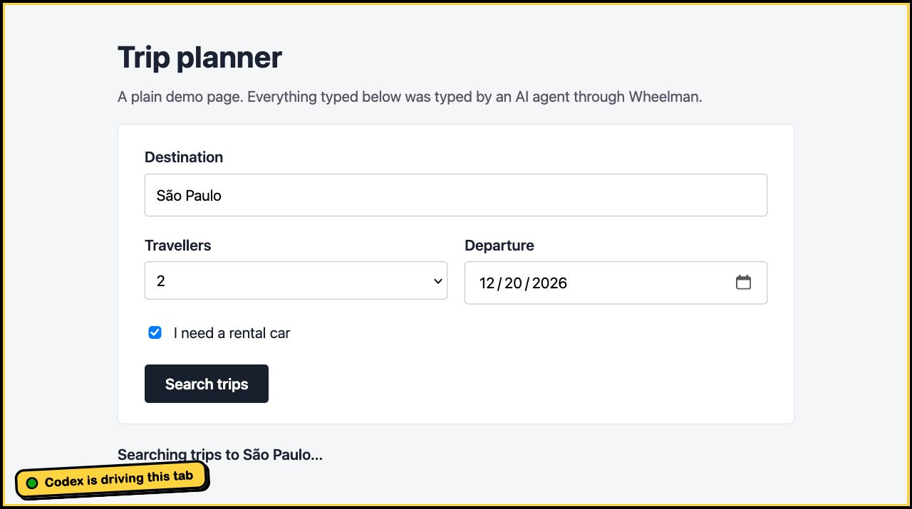
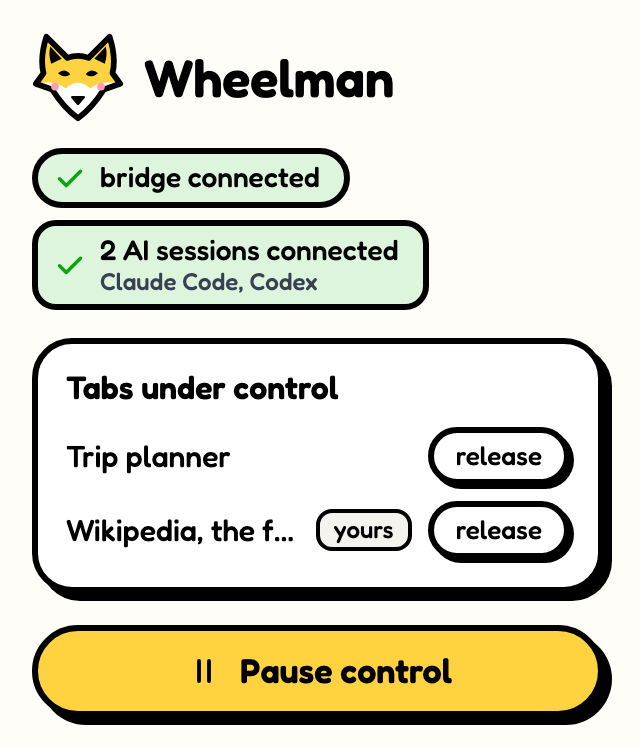

# Wheelman

Lets your AI drive Firefox: open tabs, navigate, read the page, click, type, take screenshots, and see the console and network. Works with any agent that speaks MCP: Claude Code, Codex, Gemini CLI, Cursor and others. It does what the Claude in Chrome extension does in Chrome, built from scratch for Firefox and open to every AI.

Up to version 0.1.0 the project was called Kamurafox.

Unofficial project. Not from Mozilla or any AI company.

<p>
  
  
</p>

## How it works

```
AI agent ── MCP (stdio) ── mcp-server.js ── Unix socket ── native-host.js ── native messaging ── extension
```

- `extension/`: the extension. The code that reads and touches the page is only injected into tabs the AI controls.
- `bridge/native-host.js`: the program Firefox starts when the extension loads. It opens a socket in `~/.wheelman/sockets/`, accessible only to your user.
- `bridge/mcp-server.js`: the MCP server the agent starts for each session, which talks to the socket. It also tells the extension the agent's name, which shows up in the tab notice.

Nothing goes over the network: the conversation between the AI and Firefox stays on your computer (what the AI does with what it read follows that AI's own rules).

## Install

Needs Node 20 or newer and Firefox 140 or newer, on macOS or Linux.

```sh
npm install      # development only: brings in web-ext
npm run setup    # copies the bridge to ~/.wheelman and registers it with Firefox and your AI agents
```

Then install the extension in Firefox:

- **The normal way:** download `wheelman-0.2.1.xpi` from [Releases](https://github.com/GabrielKamura/wheelman/releases/latest) and open the file in Firefox. It is signed by Mozilla and stays installed.
- **To work on the code:** `npm run firefox` opens a Firefox with its own profile (`~/.wheelman/profile`) and the extension loaded straight from the folder. Another option is `about:debugging#/runtime/this-firefox`, "Load Temporary Add-on", choosing `extension/manifest.json`.

Open a new session of your agent: in Claude Code the tools show up as `mcp__wheelman__*`.

### AI agents

`npm run setup` registers the MCP server with every agent it finds on your computer: Claude Code, Codex, Gemini CLI, Antigravity (`agy`) and Cursor. Running it again is safe. Cursor asks you to approve new servers once: `cursor-agent mcp enable wheelman`, or approve it in Cursor's settings.

Any other agent that speaks MCP works too: point it at the server in `~/.wheelman/bridge/mcp-server.js`. By hand, the commands the installer runs are:

```sh
claude mcp add -s user wheelman -- node ~/.wheelman/bridge/mcp-server.js   # Claude Code
codex mcp add wheelman -- node ~/.wheelman/bridge/mcp-server.js           # Codex
gemini mcp add -s user wheelman node ~/.wheelman/bridge/mcp-server.js     # Gemini CLI
agy mcp add wheelman node ~/.wheelman/bridge/mcp-server.js                # Antigravity
```

In Cursor, in `~/.cursor/mcp.json`:

```json
{ "mcpServers": { "wheelman": { "command": "node", "args": ["/Users/YOU/.wheelman/bridge/mcp-server.js"] } } }
```

Several AIs can be connected at the same time. The sticker on the tab says who touched it last ("Codex is driving this tab"); when the agent does not give its name, it reads "AI is driving this tab".

## Tools

| Tool | What it does |
| --- | --- |
| `tabs_context`, `tabs_create`, `tabs_adopt`, `tabs_close` | Lists, opens, adopts and closes tabs |
| `navigate` | Goes to a URL, goes back, goes forward or reloads |
| `read_page`, `get_page_text`, `find` | Reads the page structure or text, or finds elements by keyword |
| `computer` | Screenshot (with `show_mark` the frame appears in the picture), zoom, click, hover, type, keys, scroll, wait |
| `form_input` | Fills in a field, checkbox or dropdown |
| `javascript_tool` | Runs JavaScript in the page |
| `read_console_messages`, `read_network_requests` | The tab's console and network |
| `handle_dialogs`, `resize_window` | Answers `confirm`/`prompt` dialogs and sets the window size |

## Security

- The AI only acts in tabs it opened, or in tabs you told it to take over. They sit in an "AI" group and get a black and yellow frame with a notice saying who is driving, for example "Claude Code is driving this tab".
- While any AI has a tab, a tiny script (`early.js`) runs at the start of each page in the other tabs just to ask "is this tab controlled?". If not, it removes itself immediately and reads nothing from the page. It is the only way to record the console from the very first moment in controlled tabs. With no tab under control, it is not even registered.
- The extension button shows the tabs under control, releases any of them and has **Pause control**, which cuts everything off at once.
- Any program running as your user can talk to the socket. That is the same trust level as Claude in Chrome.

## Known limits

Firefox does not give extensions the debugger that Chrome does, so mouse and keyboard are synthetic DOM events:

- the native `<select>` menu does not open on click (use `form_input`);
- the file picker, the clipboard and the browser's own shortcuts are out of reach;
- pure CSS `:hover` does not trigger;
- content inside iframes is not reached yet;
- `about:` pages, `addons.mozilla.org`, the PDF viewer and reader view are blocked by Firefox itself.

## Development

```sh
npm test        # end-to-end test in a headless Firefox with a throwaway profile
npm run lint    # Mozilla's validator
npm run build   # builds the .zip in dist/
npm run sign    # signs with Mozilla (needs the key in .amo/credenciais.env)
npm run remove  # undoes npm run setup, for Firefox and every agent
```

Changed something in `bridge/`? Run `npm run setup` again: Firefox uses the copy in `~/.wheelman`.

## License

GPL-3.0. The Fredoka font follows the SIL Open Font License (`extension/fonts/Fredoka-OFL.txt`). The visual style is described in `docs/design.md`.
